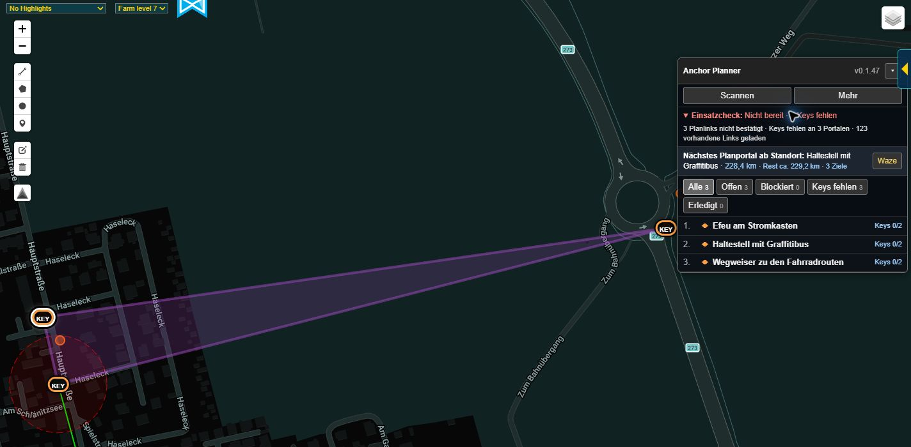
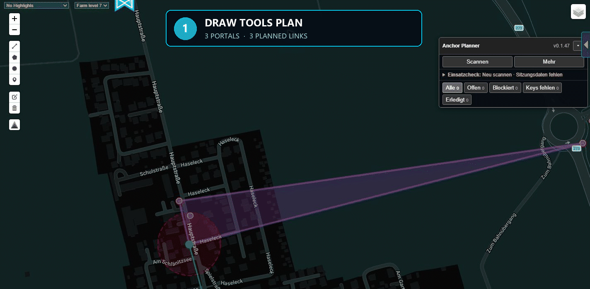

# IITC Anchor Planner

[English](README.md) | [Deutsch](README.de.md)

**Plan fields. Find blockers. Count keys. Build the route.**

Anchor Planner turns Draw Tools and Auto Draw link plans into an actionable IITC workflow: planned portals, required keys, existing links, blockers, work targets, and navigation — in one compact panel for desktop and mobile.

## See it in action

*See the whole plan at a glance: the portals involved, the keys still needed, and the next place to work.*

*Turn a Draw Tools plan into a field-ready checklist in seconds — scan it, check readiness, and open any portal for its exact key requirement.*

## Install

**Latest stable version:**

<https://raw.githubusercontent.com/emgeka/iitc-anchor-planner/main/releases/iitc-anchor-planner.user.js>

Install the `.user.js` file with your userscript manager or the corresponding IITC plugin installation method. If downloading `.user.js` files is inconvenient in your environment, the GitHub release also includes an identical `.txt` build.

Current release: **0.1.55**

<https://github.com/emgeka/iitc-anchor-planner/releases/tag/v0.1.55>

### Beta testing: 0.2.0-beta.30

This feature release targets **0.2.0**. Substantial new features increment the
minor version; patch releases are reserved for fixes and small adjustments.

The separate [beta userscript](https://raw.githubusercontent.com/emgeka/iitc-anchor-planner/beta/beta-builds/iitc-anchor-planner-beta.user.js)
supports **Show details** on both current and older IITC versions. IITC may
request details for this explicit click without moving the map. Unavailable
portal details replace the previous sidebar content with a message.

The beta adds a compact **Tasks** table with position, portal, keys, links and
blockers. Expand a row for direction, removal target, completion and navigation.
Portal names open IITC details; missing keys and the next stop are highlighted.
The view includes explicit per-link direction and directed key demand.
Blocker removal stops are inserted before dependent link tasks, choosing an
endpoint and insertion position with a small additional straight-line distance.
Automatic routing now compares complete routes, jointly revisiting portal order,
shared removal endpoints and earlier blocker detours. It accepts only shorter
variants that retain the work and its removal-before-throw dependencies.
Shared blockers occur once; work at the same portal is bundled where possible.

**Tasks → Route from location** uses IITC User Location; **Saved order** preserves
your portal order while inserting required blocker stops. Small GPS changes
keep the proposed order; movements over 100 m or changed tasks can rebuild it.
Manual blocker reports remain separate from Intel observations. The route is
a suggestion; capture, outgoing-link limits and building under fields are not
yet validated. Plan preview previews the remaining work route on the map.

Install only one Anchor Planner variant per IITC instance. The beta shares the
portal completion and settings; inventory comes exclusively from IITC Keys,
without migrating old local counts. New directions initially
remain unconfirmed. The direction selector preselects a labeled suggestion that
considers destination key stock across the open plan, reserving keys for confirmed
throws first. Route order decides otherwise equivalent choices; unknown stock is
kept distinct from zero. **Accept suggestion** confirms it; until then, key demand
remains an estimate at both endpoints. Before returning to stable, export the plan: stable ignores the
new directions and blocker task settings and uses its former key calculation.
The beta updates only from its own URL; stable remains 0.1.55. The key workflow has been confirmed in a real IITC test; separate desktop/mobile
coverage and the remaining beta scenarios are still pending.

## Why use Anchor Planner?

- **Stop counting keys by hand.** Existing planned links are detected and the remaining key demand is calculated per portal.
- **See blockers directly on the map.** Crossing loaded Intel links, affected plan links, and intersection points are highlighted automatically.
- **Know what to do next.** Open plan portals and selected blocker endpoints become a shared work route with a next target, distance, and estimated remaining route when IITC User Location is available.
- **Turn plans into a checklist.** Track keys, completion state, route order, readiness, and portal status instead of switching between separate notes.
- **Use it in the field.** The compact panel works on desktop and IITC Mobile, can be dragged out of the way, and remembers its position.
- **Share or archive the plan.** Export the plan and blocker details as readable text or JSON.
- **Use your preferred language.** German, English, Spanish, French, Italian, Japanese, Polish, Brazilian Portuguese, Russian, and Simplified Chinese are bundled.

## What it does

Anchor Planner reads Draw Tools geometry — including Auto Draw plans — and combines it with loaded IITC portals, optional Portal Bookmarks, and currently loaded Intel links.

From that data it can:

- resolve planned link endpoints to portals, diagnose unresolved endpoints,
  and load missing names for both plan portals and recognized blocker endpoints;
- detect planned links that already exist;
- calculate remaining key demand;
- detect and highlight crossing blocker links;
- run an optional bounded **Final check** for still-unconfirmed plan links at an IITC zoom that loads every link length, while skipping plan links already recognized as existing;
- prioritize useful blocker endpoints for field work;
- provide a compact readiness check for blockers, missing keys, missing names, unresolved endpoints, and limited link coverage;
- filter portals by open, blocked, missing keys, and completed; every new scan
  returns to **All** so a previous filter cannot hide the fresh result, and
  **Open** excludes portals whose planned links already exist completely;
- maintain keys, completion state, notes, and route order;
- dynamically select the next work target using the official IITC User Location plugin;
- estimate straight-line distance and remaining route;
- offer the same **Show details** and **Actions** controls for plan portals and
  blocker endpoints, with Waze, Intel, Google Maps, Apple Maps, and geo
  navigation in the shared actions dialog;
- open IITC's portal detail view for an already loaded plan portal without moving or zooming the map;
- copy or download the plan and detailed blocker information as text or JSON.

The panel can be moved by its header with mouse, touch, or pointer input. Its viewport-constrained position is restored across IITC sessions and corrected after resizing, rotating the display, or expanding and collapsing panel sections. The Anchor Planner layer keeps the visibility selected in IITC across reloads.

## Typical workflow

1. Create a link plan with Draw Tools or Auto Draw.
2. Load the relevant map area and select **Scan**.
3. Check the readiness summary and unresolved endpoints; before field work, run **Final check** for any still-unconfirmed plan links.
4. Review detected blockers and optionally add useful blocker endpoints to the work route.
5. Maintain keys and completed portals while Anchor Planner highlights the next target.
6. Navigate with Waze or another map app and export the plan when needed.

## Requirements and data coverage

- IITC with the Draw Tools plugin enabled is required for scanning.
- Portal Bookmarks improve endpoint resolution but are optional.
- Location-based target selection exclusively uses the official IITC User Location plugin. Location data is neither stored permanently nor exported.
- The normal scan only sees `window.links` currently loaded in IITC. **Final check** temporarily visits at most twelve views along still-unconfirmed plan links at the first IITC zoom without a link-length filter, waits briefly for late link-layer updates, accumulates the loaded links, and restores the original view. Existing recognized plan links are skipped. Newly recognized blocker endpoints enter the automatic name-loading pass. Progress is saved after every view, so a paused check can continue with the unchanged plan, including after reloading IITC. A capped or timed-out run is shown as **incomplete**, not as a check that was never started, and is not an all-clear.

## Community Plugins and updates

- Community ID: `anchor-planner@emgeka`
- Required plugin: `draw-tools@breunigs`
- Recommended plugin: `bookmarks@ZasoGD`
- Declared anti-features: `scraper` for automatically loading missing portal names and `export` for user-initiated plan exports
- Catalog icon: published through the userscript metadata from `docs/media/anchor-planner-icon.svg`

`scraper` follows the terminology used by the IITC Community Plugins catalog. Anchor Planner only requests missing names for plan portals and recognized blocker endpoints through IITC's own portal detail functions. Requests run sequentially and automatically after a scan; **Load names** remains available as an explicit retry if IITC could not provide details during that pass. The plugin does not search external websites, permanently collect unrelated portal data, or perform continuous background requests. The user-initiated **Final check** is capped at twelve ordinary IITC map views and does not issue its own Intel tile requests. Therefore, `highLoad` is not declared.

The stable installation URL always points to the latest published release and is intended as the source for the IITC Community Plugins catalog. Development changes under `src/` do not reach installed plugins until they have been tested and published as a release.

## Project status

- Development version: **0.2.0-beta.30**
- Latest stable release: **0.1.55**
- Development source: `src/iitc-anchor-planner.user.js`
- Published builds: `releases/`
- Userscript ID: `iitc-plugin-anchor-planner`
- IITC plugin ID: `anchor-planner`

## Support and contributions

Bug reports, translation corrections, and focused feature suggestions are welcome in [GitHub Issues](https://github.com/emgeka/iitc-anchor-planner/issues).

If you would like to support development financially, you can [sponsor emgeka on GitHub](https://github.com/sponsors/emgeka).

## Development

`main` holds the stable version; `beta` integrates development for practical
IITC testing. Larger changes use `feature/<topic>` branches and pull requests
into `beta`. Release preparation uses `release/<version>` from the tested
`beta`, followed by a pull request into `main` and synchronization back to
`beta`. See [branches, checks, and release workflow](docs/development.md).
The beta build is generated with `node src/build-beta.mjs` and checked with
`node src/build-beta.mjs --check`; stable installation and update URLs are
unchanged. `feature/task-list` introduces the integrated work plan and the
direction controls it needs. `feature/link-direction` remains the original
starting branch and should be synchronized from `beta` before future work.
Repository checks run automatically on development branches and pull requests.

The rules in `AGENTS.md` apply to the entire project. Functional changes are first made only under `src/`. Identical `.user.js` and `.txt` release builds are created only after successful practical tests with desktop IITC and IITC Mobile. The stable files without a version number are then updated to the same content.

Before every handoff, commit, or publication, each change must be reconciled with the complete set of development-relevant files. This includes the source, locales, build process, both README languages, requirements, architecture, known limitations, test scenarios, changelog, and current release files where applicable. All files must be consciously checked and every affected file must be updated in the same change set; explicitly historical releases and changelog sections retain their original state.

Translations are maintained separately under `src/locales/*.json`. Every file contains the same semantic keys and placeholders and provides its native name under `language.name`. `node src/build-locales.mjs` validates all files and bundles them into the single userscript; `node src/build-locales.mjs --check` also verifies that the bundle is current. No language files are loaded from the internet at runtime. English is the required fallback language.

## Keys import draft (0.2.0-beta.16)

Enable the official IITC **Keys** plugin. Its inventory is the only stock source;
Anchor Planner still calculates requirements. Old local counts are ignored, with
no migration. Without Keys, stock is shown as unknown and inventory inputs are disabled.
Clearing Anchor Planner data does not clear Keys. Stock updates refresh the panel and tasks.

Choose **Import keys** in the panel or tasks, select screenshots or a short video,
choose English/German recognition, and read the files. Review the portal/count table,
edit counts if needed, and apply selected rows. Unseen portals keep their counts;
conflicting observations are not preselected. Selected values replace the current count.
Only portals with known names in the current plan can be matched. Matching is conservative:
normalized exact names or unique names visibly truncated with an ellipsis, not fuzzy matching.

Processing happens locally using [Tesseract.js](https://github.com/naptha/tesseract.js).
The first run downloads OCR code/language data; images and video frames are not uploaded.
The draft supports up to 10 files, 150 MB per file and videos up to 2 minutes,
sampling once per second with one worker. Cancellation discards results after the
current OCR operation; slow scrolling improves coverage. OCR and codecs need real IITC
desktop/mobile testing. New import texts currently have German and English translations;
other UI languages use English for this draft. Inspired by Fan Fields 3's review workflow.

Inventory-card recognition now removes photographic backgrounds on predominantly dark images, using bright and dim neutral-text passes. It accepts level badges and an address row before the count, while stopping at another title. German UI preselects German OCR. The supplied real screenshot was tested locally: all five visible counts (7, 6, 10, 1, 1) were recognized. Exact matching still requires the portal to be in the current plan; unseen/ambiguous entries remain untouched.

Use **Reset all keys** in the panel or tasks to confirm setting the entire IITC Keys inventory to zero, including portals outside the plan. **Undo key change** restores the last import or reset, with a persistent backup across IITC refreshes. Later manual changes are conflicts and require explicit selection. A new non-empty import/reset replaces the previous backup; direct edits are not backed up. Browser-local undo data is separate from inventory and survives clearing the plan.

**Key inventory** in the panel or tasks shows the complete positive IITC Keys stock, including portals outside the plan, with total portal/key counts, name search and sorting by name or descending count. The list is read-only and updates on Keys changes; **Refresh** also updates known names. Names use plan portals, loaded markers and bookmarks. Missing names are marked and still counted; no background portal-detail requests.

Practical test confirmed by the user on 2026-10-06: screenshot and video key recognition, applying selected video counts to IITC Keys, inventory-list display, and complete reset → IITC refresh → undo all worked. The platform was not specified; this does not establish separate desktop and mobile coverage.

Newly detected planned links automatically deduct one key at the confirmed direction target if that link was previously observed open. First-scan existing links are a baseline; persistent Intel link identities prevent duplicate deductions across scans, reloads, map coverage gaps and imports. A rebuilt link with a new Intel identity can consume a new key after an open observation. No confirmed direction, unavailable/zero stock or interrupted writes leave a review note in Tasks; correct/import stock and choose **Inventory checked**. Consumption does not replace the last import/reset undo backup. This rule also applies to links built by other agents; Intel cannot identify whose inventory was used.

## Plan preview (0.2.0-beta.16)
Open **Plan preview** in the panel or Tasks. Step through with Previous/Next or use Play/Pause; Start again replays the same frozen route. The map shows the visited trail, simulated outgoing links and geometric triangles, plus the current stop's blocker removal and throw actions. Virtual keys decrease only for confirmed, unblocked links with available stock; unknown directions/stock and shortages are labeled. Closing clears the overlay and restores the map view. The simulation writes no inventory, completion or Intel state. Scan again after closing to resume automatic observations: preview-induced map loads must never debit real Keys. Inspired by [Fan Fields 3](https://github.com/Avataar120/fanfields3/), implemented against Anchor Planner's own work plan.

Forward steps now retain existing geometry and pan smoothly for 2.5–5 seconds according to travel distance. Automatic playback waits another 1.2 seconds after the configured movement duration before advancing. Pause/resume does not redraw or move the camera; backward steps rebuild the earlier preview. Reduced-motion preferences disable panning animation.

Joint route search uses the selected portal origin or, in GPS mode, a valid IITC User Location (**Tasks → Route from location**). Saved order and explicit removal endpoints remain authoritative; without GPS the saved order is used in location mode. The bounded search improves a baseline without guaranteeing a shortest route. It runs for up to 40 plan portals and 80 blockers; larger plans retain the baseline.

## Choose the route start
**Route from location** in the panel or Tasks plans from current IITC User Location, with feedback when GPS is unavailable. It selects automatic routing without overwriting saved portal order. **Route from this portal** in an expanded plan-portal row or task row fixes that portal as the first stop and route origin, including without GPS. The chosen portal is labeled; GPS changes do not move this origin. If its throws require removal elsewhere, the first stop marks the route origin and the route returns to throw after removal. Only the portal GUID is saved; scan again after reload to resolve it. Missing start portals are labeled. Saved order or Route from location clears the fixed start. **Plan preview** replaces the name Walk Sim; preview and route distance use the selected origin. New portal-start explanations use English outside German/English.

Only stops with remaining link tasks or blocker removal enter the work route. Receiving portals and unused direction candidates stay visible in the plan but are skipped by the route. Unknown directions retain a clearly unconfirmed link task. An explicitly chosen starting portal remains labeled **Route start**, without inventing preparation work.

The cyan travel trail grows progressively to the moving position marker over the same 2.5–5 seconds as the camera movement; Previous retracts the final segment. The route origin is included in the trail. Changing steps cancels old animation frames; closing removes the animation. Reduced motion disables trail and marker animation as well.

## Next task (0.2.0-beta.16)
Open **Next task** in the panel or Tasks for a compact live view of the first remaining work stop: portal, GPS distance, Waze/Google Maps, blocker removal before link tasks, direction controls and keys needed at each destination. Route origins are context, not extra work. Scan, GPS routing and the full task list remain directly available. Manual reports use the existing controls and do not confirm Intel or debit Keys. The view updates after scans, task/Keys changes and location updates. Unscheduled work and incomplete readiness remain visible. Additional explanations use English outside German/English.

## Choose a function (0.2.0-beta.22)
The start page offers two separate entries and global Settings. It contains no scan, task, key, routing or fan-design actions. **Anchor portals** opens the external Draw Tools/Auto Draw plan; **Fan planner** always opens a fresh design from the current polygon; a saved fan is opened only through **Use saved fan plan**. **Home** returns to the function chooser without deleting either plan. Every IITC refresh starts at this chooser; the active plan remains saved separately.

The Anchor portals area provides its own scan, readiness, portal list, tasks, Keys and routing, without fan-design controls. The Fan planner area provides **Design fans** when there is no accepted plan, or **Design a new fan**, **Refresh plan**, tasks and routing for the accepted fan. Coordinate matching tolerance belongs only to Anchor portals. Shared inventory remains in IITC Keys. **Settings** owns language and global Clear data; that action removes saved native geometry and portal/link settings while preserving external drawings and Keys.

For a fan, draw a simple Draw Tools polygon first, then open **Fan planner**. Choose the polygon if there are several; the newest polygon is preselected. **Load portals** uses loaded portals inside/on the boundary, automatically suggests anchors and draws the proposal. The loaded map remains an explicit alternative; the unrelated current anchor plan is no longer offered as a source.

In **Suggest anchors**, enter the **Desired anchor count**. One, two or more anchors are supported: the valid range is 1 to one fewer than the active selected portals, capped at 199. Pinned anchors and manually assigned anchor targets count toward this total. If the requested number is smaller than those fixed choices, the planner explains the conflict instead of silently increasing it. Editing the number clears the previous preview and disables **Use plan**; leaving the field or pressing **Suggest anchors** calculates a fresh proposal. Pin manual anchors, assign each portal to one anchor or exclude it. Review **Preview**, then **Use plan**. Anchor Planner saves and draws its own geometry and opens the fan working area. New directions remain unconfirmed until selected in Tasks. Accepted selection outlines are ignored in the external scan. To return to the external plan use Home → Anchor portals; to restore a saved fan use Home → Fan planner → Use saved fan plan. Removing a fan leaves its design area empty and keeps the external geometry available.

Missing portal names load automatically before acceptance, including oversized selections; the dialog shows progress and **Load names** retries failures. Resolved names are preserved across refresh. Geometry supports 3–200 selected portals; reduce the polygon or exclude portals after identifying them. Loaded Intel and geometric triangle counts do not guarantee an optimal or executable Ingress build sequence. Simple concave polygons are supported; holes/multipolygons are rejected.

Returning Home pauses Final check, stops Plan preview and closes working dialogs (including imports) to prevent stale context. Tasks, Next task, Plan preview and exports identify their active function. Inventory and per-portal/per-link settings remain shared. Export before switching to stable, which ignores native geometry and plan-source metadata. Inspired by [Fan Fields 3](https://github.com/Avataar120/fanfields3/), implemented independently.

Beta.23 fixes unintended restoration of previous fan anchors/assignments and polygon selection. Fresh drafts do not display old anchor-plan readiness or blocker-check errors. Above 60 portals, a bounded angular fan avoids all leaf pairs; geometric triangle counting uses adjacency. A generated proposal remains separate from the saved plan until explicit acceptance.

### Blocker factions and fixed portal badges (beta.24)
Blocker tasks show friendly/enemy/unknown relation and Resistance/Enlightened/Machina faction. Friendly removal/flipping needs coordination; enemy removal is planned at the chosen endpoint. Colours: friendly amber, enemy red, unknown grey. All crossing factions remain blockers; no team is silently ignored. A known enemy link on the planned pair is a removal task, not an already-completed friendly throw, and never debits your Keys. Counts appear in the blocker panel; faction metadata survives paused Final check and JSON export. Missing data stays unknown; legacy existing-link handling remains when relation cannot be determined.
Portal key-status badges now use geographic Leaflet markers instead of fixed container pixels, so they remain attached during animated travel, pan and zoom. Group visibility and status updates are preserved; an unsupported-runtime HTML fallback follows move events. Native marker placement uses the standard [Leaflet Marker/DivIcon API](https://leafletjs.com/reference.html#divicon).

### Anchor count and key-aware directions (beta.25)
The fan proposal uses the exact requested anchor count when valid; high counts can still produce crossing spokes or no fields, which prevent acceptance. Anchor selection and fan geometry do not optimize Keys. Once a plan is accepted, Tasks suggests throw directions using the existing IITC Keys stock: reserve confirmed open destination demand first, then distribute remaining known capacity jointly across unconfirmed links. Earlier suggestions can move to the opposite endpoint to leave a scarce key for another link. For uncovered links, unknown destination stock is preferred over known exhausted stock; route order breaks other ties. Open, unfinished plan portals can become throw sources even if the previous route skipped them.
The bounded search supports at most 600 unconfirmed links and 200,000 visits; larger or interrupted searches retain a fallback without guaranteeing stock coverage. Suggestions do not change inventory or confirm directions, and they do not guarantee capture, access or legal field construction. Accept each direction explicitly and review the resulting demand. On 2026-10-22 the user confirmed both the desired anchor count and key-aware throw directions in a practical plugin test. The platform was not specified; separate desktop/mobile coverage and remaining edge cases are still pending. Stable stays 0.1.55.

### Consistent interface (beta.26)
The panel and every Anchor Planner dialog share a dark navy theme with the same type, controls, spacing and tables. Dialog title bars and footers use the same appearance; primary and destructive actions remain visually distinct. Keyboard focus, hover and disabled states are consistent, and controls grow for touch use. Dialog widths adapt to the available screen.
The separate Anchor portals and Fan planner workflows, saved plans, Keys, routing and map-marker meanings are preserved. A local wide/360-pixel browser fixture has been checked with synthetic data and a simulated IITC dialog frame. Practical IITC/mobile testing remains pending; the beta does not replace stable 0.1.55.

Beta.27 restores the titlebar icons: close (×), collapse (−) and expand (+). Checked locally with the original IITC dialog implementation at desktop and 360-pixel widths; verification in the installed plugin remains pending.

### Final-check loading (beta.28)
Allow up to 30 seconds per view and verify fully rendered, matching cached coverage even when IITC emits no new refresh hooks. Count only successfully loaded views. Failed or unconfirmed loads remain incomplete; **Resume check** retries only those views while retaining successful coverage, including after reload. The result distinguishes loading problems from the unchanged twelve-view cap. It does not issue extra tile requests or guarantee server completeness. Automated regression checks pass; actual desktop/IITC Mobile confirmation is pending.

### Target plan, travel and progress (beta.29)
Resolved links and geometric target fields remain visible in muted purple, for both the active external plan and the accepted fan plan. Keys, confirmed directions and simulation progress do not hide this target. Plan preview distinguishes the orange travel route from cyan simulated throws/new fields; its legend explains all three. Rewind preserves the target, and closing restores the permanent target overlay. Preview totals refer to simulated work, not the target. Geometric triangles do not validate an Ingress build order. Very dense plans retain all resolved links but limit shading to 2000 fields or 200000 adjacency checks, with an explicit notice.

### Readable blocker overlays (beta.30)
Blockers use thin translucent lines by default, leaving the target plan readable. Selecting a blocker strongly highlights that connection and its yellow crossing. **Show all blockers** in the workspace or Plan preview restores full highlighting and all distinct crossing markers; **Clear selection** removes the focused highlight. These synchronized display controls do not filter blockers or change tasks, routing, Keys or completion. Home/reload returns to the quiet default.
